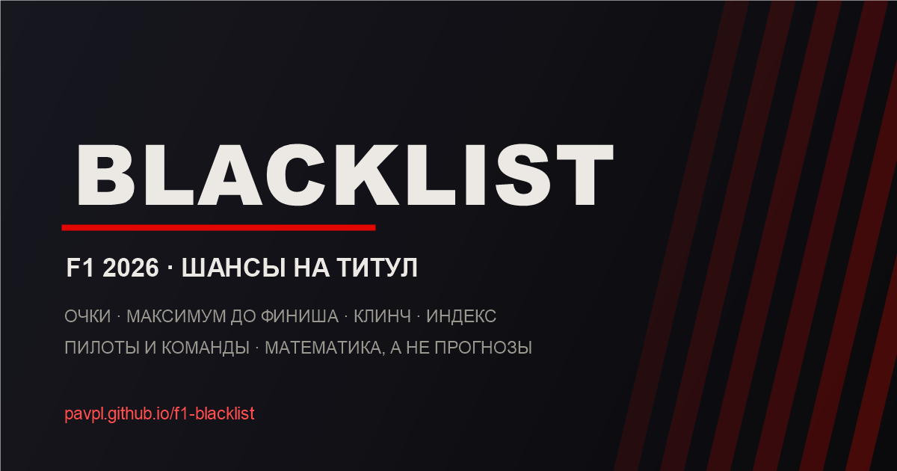

# F1 Blacklist — калькулятор шансов на титул

Одностраничное приложение без сборки: считает **математические** шансы пилотов и команд на титул
Формулы-1 в сезоне **2026**. Данные подтягиваются из открытого Jolpi API, календарь — из того же
источника с запасным встроенным списком. Ввод очков вручную не предусмотрен: источник истины — API.

**Демо:** <https://pavpl.github.io/f1-blacklist/>



## Возможности

- **Автозагрузка данных** из Jolpi API: положение пилотов, кубок конструкторов и календарь.
- **Две таблицы:** пилоты и команды, с одинаковой логикой «максимум — отставание — индекс — статус».
- **Карточки и таблица** — переключаемый вид, выбор запоминается.
- **Флаги и командные знаки:** локальные SVG-флаги пилотов и стилизованные эмблемы команд в их
  цветах (не официальные логотипы).
- **Фильтры и поиск:** все / в борьбе / выбыли, поиск по имени, команде, номеру.
- **Математический статус:** «В игре», «Титул закреплён», «Чемпион», «Выбыл», с печатью `BUSTED`.
- **Индекс потенциала** показывается для всех, включая выбывших, — чтобы было видно, насколько
  далёк их потолок от потолка лидера.
- **Максимум до конца сезона**, отставание, победы и **клинч** для лидера.
- **Следующий этап и обратный отсчёт**, прогресс сезона, число оставшихся спринтов.
- **Кэш и офлайн:** свежие ответы API хранятся 15 минут (календарь — час), при сбое показываются
  последние сохранённые данные с пометкой.
- **PWA:** service worker кэширует оболочку, флаги, манифест и иконки; приложение можно установить.
- **Доступность:** нативный `<dialog>`, ARIA-атрибуты, клавиатурная навигация по вкладкам,
  `focus-visible`, `prefers-reduced-motion`, контрастная тёмная тема.
- **Адаптивность:** карточки и таблица корректно работают на телефоне, планшете и десктопе.

## Как это считается

Для каждого участника берётся его текущий результат `P` и максимум `W` за оставшиеся этапы:

| Этап                  | Максимум пилота | Максимум команды |
| --------------------- | --------------- | ---------------- |
| Обычный уикенд        | 25              | 43               |
| Спринт-уикенд         | 33              | 58               |

Максимум команды — это сумма очков двух пилотов за первое и второе места: 25 + 18 = 43 в гонке и
8 + 7 = 15 в спринте.

- **Максимум участника:** `M = P + W`.
- **В борьбе:** `M >= P_лидера`. Если строго меньше — даже идеальный сценарий не позволяет догнать
  лидера, участник выбывает.
- **Индекс потенциала:** `(P + W) / (P_лидера + W) * 100`, но не больше 100%. Если у лидера 0 очков
  (старт сезона), индекс равен 0. После финиша сезона `W = 0`, и индекс превращается в `P / P_лидера`.
- **Клинч:** единоличный лидер гарантирует титул, если `P_лидера > P_второго + W`. Иначе
  **число клинча** — сколько очков лидеру нужно набрать больше ближайшего соперника, чтобы
  гарантировать титул: `P_второго + W - P_лидера + 1`.

Очко за лучший круг не учитывается, как и в текущем спортивном регламенте.

## Данные

- Положение пилотов: `https://api.jolpi.ca/ergast/f1/current/driverStandings.json`
- Кубок конструкторов: `https://api.jolpi.ca/ergast/f1/current/constructorStandings.json`
- Календарь: `https://api.jolpi.ca/ergast/f1/current.json`

Используются официальные `position` и `wins` из API для сортировки и тай-брейков. Запросы идут с
таймаутом 10 секунд и одной повторной попыткой. Ответы кэшируются в `localStorage`; если API
недоступен, приложение показывает последние сохранённые данные и предупреждает об этом. Если
недоступен календарь, подставляется встроенный список этапов.

## Сезон 2026 в проекте

- 23 этапа, 23 пилота, 11 команд, включая Audi и Cadillac.
- Спринт-уикенды: Китай, Майами, Канада, Великобритания, Нидерланды, Сингапур.
- Этапы в Бахрейне и Саудовской Аравии отменены, их место занял этап в Малайзии (Сепанг), который
  в календаре проекта идёт как 16-й раунд.
- В состав пилотов включён Юки Цунода как запасной/подменный.

## Структура

| Файл | Назначение |
| --- | --- |
| `index.html` | Разметка, метатеги, диалог «Как это считается» |
| `styles.css` | Оформление, адаптив, состояния загрузки/ошибки |
| `data.js` | Статичные метаданные: команды, пилоты, флаги, русские названия этапов, запасной календарь |
| `calc.js` | Чистая математика: максимумы, индекс, статусы, клинч, отсчёт (тестируется отдельно) |
| `api.js` | Сеть: таймаут, повтор, кэш, обработка ошибок |
| `render.js` | Шаблоны карточек, таблиц, сводки и состояний |
| `assets/flags/` | Локальные SVG-флаги пилотов и лицензия `flag-icons` |
| `app.js` | Состояние, загрузка, фильтры, сортировка, события, service worker |
| `tests/` | Юнит-тесты на `node:test`: расчёты и рендер-утилиты |
| `sw.js` | Service worker для офлайн-оболочки |
| `tools/make-assets.ps1` | Генерация PNG-иконок и `og.png` (Windows PowerShell) |

## Локальный запуск

Приложение не требует сборки, но из-за ES-модулей его нужно открывать через сервер, а не
двойным кликом по `index.html`:

```bash
python -m http.server 8080
# или
npx serve .
```

Затем откройте <http://localhost:8080>.

Полезные параметры: `?nowelcome=1` — не показывать приветственное окно, `?view=constructors` —
открыть команды, `?layout=table` — открыть таблицу, `?filter=alive` — оставить только тех, кто ещё
в борьбе, `?sort=index` — отсортировать по индексу, `?nosw=1` — не регистрировать service worker
(удобно при отладке).

## Тесты и CI

```bash
npm test        # node --test
npm run check   # синтаксис всех JS-файлов + тесты
```

В `.github/workflows/ci.yml` те же проверки выполняются на каждый push и pull request.

## Лицензия

MIT. Проект неофициальный и не связан с Formula 1, FIA или командами. «Blacklist» — отсылка к
эстетике *Need for Speed: Most Wanted*.

Иконки флагов взяты из проекта [flag-icons](https://github.com/lipis/flag-icons) (MIT); полный
текст лицензии — в `assets/flags/LICENSE`. Флаги Испании и Мексики упрощены для размера иконки.
Командные знаки — стилизованные элементы интерфейса, а не официальные логотипы команд.
